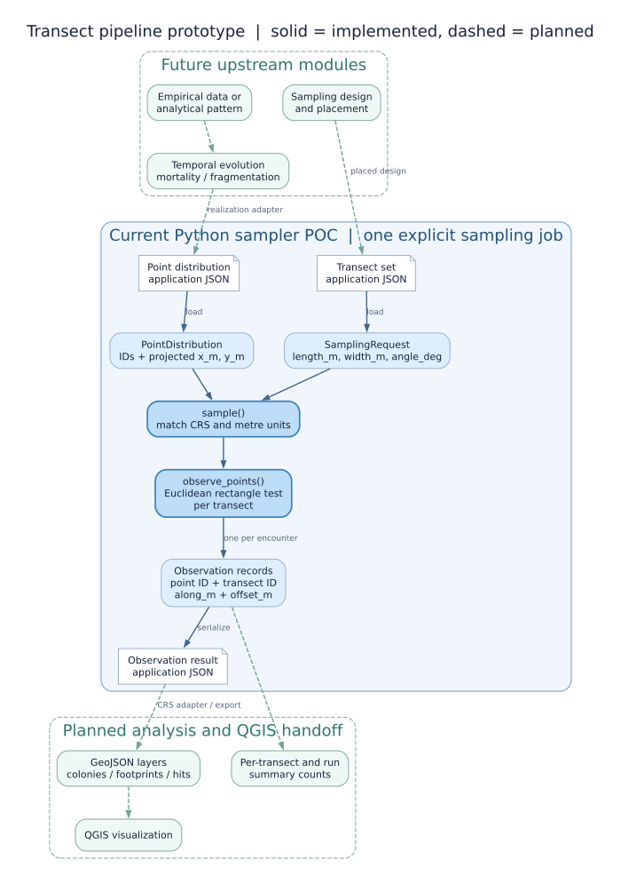

# Python transect sampler proof of concept

The pre-refactor cycle is complete. See the [next feature release guide](next_feature_release.md) for the prioritized backlog and compatibility constraints; the interface and MVP descriptions below remain design references.



The diagram source is [`pipeline_prototype.dot`](pipeline_prototype.dot). Solid arrows show the working Python proof of concept; dashed arrows show planned modules and exports.
Regenerate the SVG with `dot -Tsvg docs/pipeline_prototype.dot -o docs/pipeline_prototype.svg`.

## 1. Overall pipeline

```text
distribution source -> spatial realization -> temporal evolution -> spatial realization
                                                              |
sampling design / placements ------------------------------- sampler
                                                              |
                                               observations -> summary statistics
```

The distribution source may read empirical colonies or draw a realization from an analytical spatial model. Its output is a snapshot with stable entity IDs, geometry, coordinates, CRS, units, and provenance. A temporal module can transform a snapshot at a particular time: mortality may remove colonies or reduce cover, while fragmentation may produce new entities with parent IDs. The sampler receives one snapshot and one sampling request; the summary stage receives its observation records. Future orchestration can run independent realizations, time steps, and sampling requests in parallel because the sampling core has no global state or random draws.

The prototype implements the last query for point centers. It does not model the source distribution, evolution, random transect placement, or detection probability.

## 2. Sampler interface

The current CLI uses versioned, application-specific JSON and typed Python objects. **GeoJSON is the selected file format for spatial interchange and QGIS visualization** in the refactor: it retains long field names, is straightforward to parse, and is supported by many GIS tools. A small JSON manifest can carry experiment settings and provenance. The current JSON examples are not GeoJSON and the CLI does not yet read or write GeoJSON. See the concise refactor assessment below.

Python entry point:

```python
observations = sample(distribution: SpatialDistribution, request: SamplingRequest)
```

`SpatialDistribution` is an adapter protocol with `id`, `crs`, `units`, and `observe(transect, sampling_id)`. The first adapter is `PointDistribution`, an arbitrary arrangement of uniquely identified points. A later analytical model should first generate a concrete spatial realization, then provide an adapter for its geometry. That keeps a repeated query against the same realization stable. Raster or polygon adapters can implement the same protocol once their observation semantics are defined.

The distribution input (`examples/point_distribution.json`) has `schema_version: "1"`, `kind: "points"`, `distribution_id`, optional `realization_id`, `crs`, `units: "m"`, and a `points` array. Each point has a unique string `id`, numeric `x_m`, numeric `y_m`, and optional JSON `attributes`. The IDs identify entities within one realization; attributes can carry cover, species, lineage, or time labels without changing the geometry query. The CLI currently accepts only `kind: "points"`.

The sampling request (`examples/transects.json`) has `schema_version: "1"`, `sampling_id`, matching `crs` and `units`, and a nonempty `transects` array. Each transect has a unique `id`, `start_x_m`, `start_y_m`, `length_m`, `width_m`, and `angle_deg`. The start point is the first end of the rectangle's centerline. The angle is counterclockwise from positive X; length runs along the centerline, width extends equally on both sides. The sampler tests point centers against the closed rectangle, including edges and end caps. It does not clip to a study window or use colony size/cover. Boundary comparisons allow 16 floating point units in the last place at the local transect scale to absorb rotation roundoff; the scientific boundary rule still needs confirmation.

The output is a JSON document with schema version, distribution and realization IDs, sampling ID, CRS, units, `transect_ids`, and an `observations` array. Each observation carries `sampling_id`, `transect_id`, `point_id`, point coordinates `x_m` and `y_m`, `along_m` distance from the transect start, signed `offset_m` from its centerline, and copied point attributes. Transect IDs remain in the output even for zero hits. Overlapping transects yield a separate observation for each hit; the caller chooses whether a later summary should count unique colonies or transect encounters. Observation order follows the request's transect order and then the source point order. No counts or probabilities are stored in this raw result.

Example CLI:

```bash
PYTHONPATH=src python -m transect_sampler sample \
  --distribution examples/point_distribution.json \
  --transects examples/transects.json \
  --output /tmp/transect_observations.json
```

One invocation processes one realization and one sampling request, so an orchestrator can give each job a distinct output path. Validation rejects duplicate IDs, nonfinite coordinates, nonpositive dimensions, unmatched CRS or units, and unsupported distribution kinds. Input files are read only; the requested output path is written as JSON.

## 3. Scope of the implementation

This is a new implementation boundary, not a port of `process/transectGenerator.m`. It neither reproduces the legacy east-west strip placement nor consumes the legacy CSV files directly. The observed `data/points_*.csv` files have no ID or CRS metadata; `data/Sim_*.csv` mixes 100 realizations into each file. Import adapters will need to assign stable IDs, split realizations, and attach verified CRS metadata. The legacy PDF's sampling designs can later be represented as explicit transect sets once placement rules are settled.

## 4. GIS and metric geometry assessment for the refactor

- The sampling kernel already uses planar Euclidean projection: it rotates `(point - transect start)` into along and cross-transect distances and tests a rectangle. No geodesic distances are calculated. This is appropriate for the intended small survey windows when both inputs use the same suitable projected CRS in metres. It performs no CRS transformation and currently validates only matching CRS strings and `units: "m"`; these checks do not prove that a CRS is projected or metre based.
- Operational Python fields use `x_m`, `y_m`, `start_x_m`, `start_y_m`, `length_m`, `width_m`, `along_m`, `offset_m`, and `angle_deg`. This makes units visible at the API and JSON boundary. The `_m` coordinates are easting/northing or local Cartesian coordinates, never GeoJSON longitude/latitude. The synthetic `LOCAL:METRES` examples have no geographic location and cannot be reprojected into standard GeoJSON.
- The original `data/original/window_260.qpj` declares REGVEN / UTM zone 19N (`EPSG:2202`). Treat this as evidence for that source shapefile, not automatic CRS metadata for every CSV or simplified polygon. Confirm the CRS of each historical input before import.
- Standard [GeoJSON (RFC 7946)](https://www.rfc-editor.org/rfc/rfc7946#section-4) uses WGS 84 longitude/latitude in degrees. The planned adapter must transform GeoJSON geometry into a verified local projected CRS before sampling and transform spatial results back for export. It must reject unavailable or ambiguous transformations rather than interpreting degrees as metres. Geometry should remain the source of spatial position; stable IDs and experiment metadata belong in feature properties and the run manifest.
- Proposed input files: colony realization as Point GeoJSON and transect centerlines as LineString GeoJSON with `width_m` and IDs. The MVP outputs observed Point features and derived transect footprint Polygons for QGIS. Keep the footprint layer even when it has zero hits. A manifest records schema version, source/working/export CRS, realization ID, sampling ID, transformation details, and file names. This is a design target, not implemented I/O.
- GeoJSON is chosen over Shapefile for this interface because [Shapefile attribute names are limited to ten characters](https://gdal.org/en/stable/drivers/vector/shapefile.html). File based CSV and historical Shapefiles remain import sources; no database format is planned. Confirm GeoJSON round-trip fidelity, precision, IDs, properties, and QGIS rendering with a small fixture before bulk conversion.

## 5. MVP feature: inspect one sampling run in QGIS

Provide a CLI command that accepts one colony realization and one explicitly placed transect set, runs the metric sampler once, and writes a self-contained output directory. This is a planned feature; the current CLI writes only application-specific observation JSON.

Minimum artifacts per run:

| File | Contents | QGIS use |
| --- | --- | --- |
| `colonies.geojson` | Input realization as Point features with stable `point_id` | Show the sampled population |
| `transects.geojson` | Derived rectangular Polygon features with `transect_id` and `hit_count`; include zero-hit transects | Display sampling footprints and color by count |
| `observations.geojson` | One Point feature per transect–colony encounter with both IDs and `along_m`/`offset_m` | Inspect detected colonies and overlap |
| `summary.json` | Per-transect hit counts, total encounters, and distinct colonies across the run | Read results without GIS; feed later statistics |
| `manifest.json` | Schema version, source and working CRS, transformations, realization and sampling IDs, parameters, and artifact names | Reproduce and interpret the run |

GeoJSON geometries must be exported in WGS 84 longitude/latitude; the sampler computes footprints and hits in the verified projected metre CRS. Keep raw point IDs as string properties and give encounter features distinct IDs so overlapping transects remain visible. `hit_count` counts encounters in each transect; the run total counts all encounters, while the distinct-colony total deduplicates point IDs across transects. These are descriptive counts, not detection probabilities. A useful acceptance check is to open the three GeoJSON files together in QGIS, see every transect including zero-hit cases, identify each observed colony by both IDs, and reconcile polygon counts with `summary.json` and the raw observations. The MVP needs no in-app map or database.

## 6. Follow-up actions

1. Define the scientific observation rule for colony footprints, partial intersection, cover, visibility, and points on boundaries. Add geometry adapters and a numerical tolerance policy as needed.
2. Add a sampling design/placement module: explicit placements first, then seeded random placement subject to the chosen window and clipping rules. Keep random state and seeds in experiment metadata.
3. Create validated importers for historical observed and simulated CSV data, including a verified CRS/UTM zone and stable realization/entity IDs. Implement the GeoJSON adapters and manifest described above, with explicit reprojection at their boundary.
4. Add distribution generators and temporal transitions as separate modules, with provenance and parent/child identity for fragmentation.
5. Add a summary module for counts, unique detections, detection probability, uncertainty, and fair comparisons across designs, after the statistical estimand is agreed.
6. Expand unit and integration tests for rotations, boundaries, overlaps, zero hits, malformed data, CRS mismatches, GeoJSON reprojection and round trips, importer behavior, and synthetic analytical cases. Compare selected outputs with Octave only after deciding which legacy semantics to preserve.
7. Document the GeoJSON and manifest schemas, coordinate conventions, installation, reproducible batch orchestration, and future API behavior. Add an experiment runner if data volume warrants it.
8. Deliver the QGIS inspection MVP above with a CLI output-directory option and a small georeferenced fixture. Verify exported geometries, CRS, IDs, zero-hit features, and summaries by opening the artifacts in QGIS.
